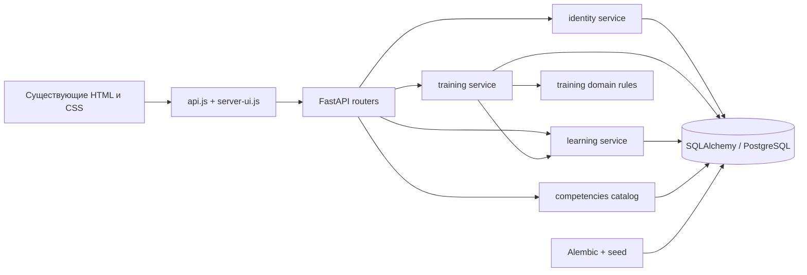
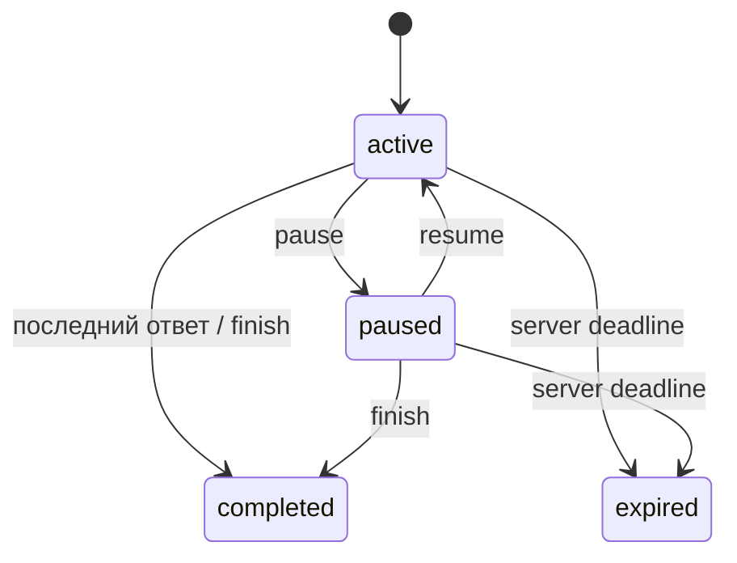

# Архитектура

Основное решение — [ADR-0001](decisions/0001-modular-monolith.md); хранение и безопасность — [ADR-0002](decisions/0002-storage-and-auth.md).

Реализованные модули: identity владеет пользователями, сеансами и DB-лимитами; competencies — каталогом и опубликованными версиями вопросов; training — состояниями, снимками вопросов, ответами и детерминированной проверкой; learning — версиями плана, агрегатами аналитики и избранным. Профиль пока достаточно прост для таблицы users. Отдельные profiles/analytics без дополнительных обязанностей не создаются.

HTTP валидирует Pydantic-схемы и вызывает прикладные сценарии. `training/domain.py` не импортирует FastAPI, ORM и SDK. SQL-запросы находятся в серверных сервисах; каталог и CRUD избранного остаются простыми операциями. `models.py` только регистрирует metadata для миграций. `main.py` собирает приложение, middleware и отдаёт UI.

Транзакции: регистрация+создание auth session; ответ+оценка+переход сессии+новый план; завершение+план. Лимиты запросов коммитятся отдельно до сценария, поэтому неверный пароль не возвращает попытку в лимит. Оптимистичная revision и уникальные ограничения предотвращают двойную запись; PostgreSQL дополнительно блокирует строку сессии и пользователя при выделении версии плана. Повтор с тем же request_key и другим payload отклоняется. Конфликт конкурентной записи возвращает 409 и требует повтор с прежним ключом.

Контрольный срок не останавливается на паузе. Подсказки только practice, диагностика и exam без них. До завершения сервер не выдаёт expected/correct/criteria. После завершения разбор принадлежит владельцу. Истечение вычисляется сервером при обращении к деталям/мутации; список истории может показывать старый статус до открытия. Это текущая известная граница, будущий worker может завершать сессии автоматически.

Сервер использует существующие файлы страниц/стилей. При выдаче HTML убирает legacy scripts и для неавторизационных страниц заменяет локальное содержимое на loading shell. `server-ui.js` наполняет его серверными данными. CSS, шрифты, темы, auth-разметка сохранены. Банк ответов и прежние скрипты не раздаются сервером. Сложные исходные компоненты будут интегрироваться дальше; текущий адаптер обеспечивает основные маршруты, а не завершение визуальной миграции всех экранов.

## Запланированные границы ИИ

knowledge: документы/версии/чанки/embeddings, ACL и retrieval; assessment: фиксированные критерии, задания и проверка структурированных оценок; серверные adapters: LLM и embeddings; persistent jobs: ingestion/evaluation с lease и retry. Они пока **не реализованы**. Провайдеры не влияют на предметные правила; embeddings индексируются по модели и размерности. Уточнение схемы — отдельная миграция/ADR на этапе 4.

Официальные API сверены перед использованием: [SQLAlchemy Session](https://docs.sqlalchemy.org/en/20/orm/session_basics.html), [Alembic tutorial](https://alembic.sqlalchemy.org/en/latest/tutorial.html), [FastAPI security/pwdlib](https://fastapi.tiangolo.com/tutorial/security/oauth2-jwt/). Фактически установленные версии фиксируются `requirements.lock`, JS — `package-lock.json`.
