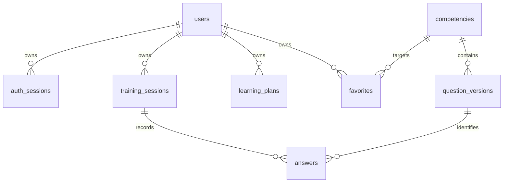

# Модель данных

В этом документе реализованная схема отделена от проектируемой. Авторитетная реализация — миграции `backend/migrations/versions/`.

| Таблица | Владелец | Ограничения и назначение |
|---|---|---|
| users | identity | UUID PK, unique lowercase email, hash Argon2id; name и QA direction |
| auth_sessions | identity | SHA256 token PK, user FK cascade, CSRF, expiry index |
| rate_windows | identity | хеш окна и идентификатора PK, счётчик, expiry index |
| competencies | competencies | stable id PK, topic index, prerequisites/levels/criteria/source references JSON |
| question_versions | competencies | stable slug + positive version unique, competency FK, published flag, content JSON |
| training_sessions | training | owner+created index, owner+request_key unique, status/mode CHECK, revision, question snapshots JSON |
| answers | training | session+question unique, session+request_key unique, score CHECK 0–100, evaluation JSON |
| learning_plans | learning | owner+version unique, rules version, ordered items snapshot |
| favorites | learning | owner+competency composite PK |

Время — Unix seconds UTC; интерфейс отображает локальное время браузера. Снимок задания в сессии сохраняет формулировку, версию, критерии, ожидаемый ответ и источники до ответа. В Answer фиксируются ответ, hint_used, вычисленная оценка, источники и критерии; deterministic method version, model/prompt=null, parameters={}. Это намеренно не выдаётся за запуск ИИ. Старые snapshots не пересчитываются при публикации новой версии.

QuestionVersion immutable по соглашению приложения: HTTP редактирования пока нет, seed не меняет существующие записи. Доступ к БД администратора может нарушить инвариант; нужна процедура новой версии вместо UPDATE. Источник сейчас ссылка, а не сохранённая версия документа, поэтому воспроизводимость внешнего содержимого ещё не обеспечена. Она требует этапа 4.

## Следующие сущности (проект, не готовые таблицы)

- knowledge_documents: владелец/общая область, формат, исходное имя, размер, hash, lifecycle;
- document_versions: immutable text, URL/file origin, дата получения, язык, версия, лицензия;
- chunks: версия документа, структурный путь/страница/offset, текст, тема, competency;
- embeddings: chunk + embedding_model + index_generation, размерность и вектор pgvector;
- rubrics: question version, критерии/веса/expected elements, публикация;
- criterion_scores: answer, criterion snapshot, score, evidence spans, errors;
- jobs: durable state, attempts, next_run, lease owner/expiry, bounded retries;
- ai_runs: purpose, model, prompt/version, parameters, context/source ids, status, timing, usage/cost.

Пользовательские документы и общая база требуют ACL-фильтра **до** retrieval/LLM. Удаление частного документа должно каскадно удалить original/text/chunks/embeddings; старые отчёты потребуют отдельной политики удаления частного контекста без незаметной перегенерации оценки. Вопрос не решён в текущем этапе и будет закреплён ADR до загрузки документов.
