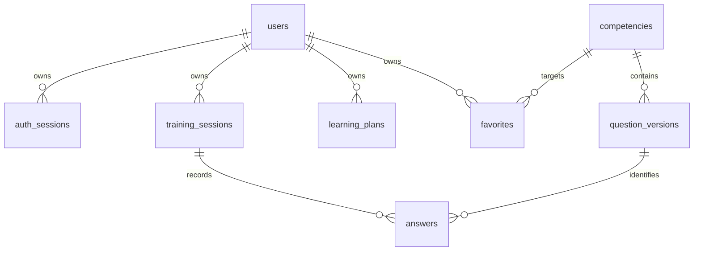

# Модель данных

В этом документе реализованная схема отделена от проектируемой. Авторитетная реализация — миграции `backend/migrations/versions/`.

| Таблица | Владелец | Ограничения и назначение |
|---|---|---|
| users | identity | UUID PK, unique lowercase email, hash Argon2id; name и QA direction |
| auth_sessions | identity | SHA256 token PK, user FK cascade, CSRF, expiry index |
| rate_windows | identity | хеш окна и идентификатора PK, счётчик, expiry index |
| competencies | competencies | stable id PK, topic index, prerequisites/levels/criteria/source references JSON |
| question_versions | competencies | stable slug + positive version unique, competency FK, published flag, content JSON |
| training_sessions | training | owner+created index, owner+request_key unique, status/mode CHECK, revision, question snapshots JSON |
| answers | training | session+question unique, session+request_key unique, score CHECK 0–100, evaluation JSON |
| learning_plans | learning | owner+version unique, rules version, ordered items snapshot |
| favorites | learning | owner+competency composite PK |
| knowledge_documents | knowledge | scope CHECK; private требует owner; current_version, title |
| document_versions | knowledge | document+version unique; text/hash/source_title/URL/language/license/received_at/competency/status/chunker_version |
| knowledge_chunks | knowledge | version+ordinal unique; section, offsets и actual text; FK cascade |
| chunk_embeddings | knowledge | chunk+model_key unique; PostgreSQL native vector, SQLite JSON только для contract tests |
| ingestion_jobs | knowledge | version+model_key unique; state CHECK; claim index, lease/token, attempts, available_at, безопасный error_code |

Время — Unix seconds UTC; интерфейс отображает локальное время браузера. Снимок задания в сессии сохраняет формулировку, версию, критерии, ожидаемый ответ и источники до ответа. В Answer фиксируются ответ, hint_used, вычисленная оценка, источники и критерии; deterministic method version, model/prompt=null, parameters={}. Это намеренно не выдаётся за запуск ИИ. Старые snapshots не пересчитываются при публикации новой версии.

QuestionVersion immutable по соглашению приложения: HTTP редактирования пока нет, seed не меняет существующие записи. Доступ к БД администратора может нарушить инвариант; нужна процедура новой версии вместо UPDATE. В question sources пока справочные ссылки, не FK на version корпуса. Авторские тексты корпуса уже версионированы отдельно; следующие генерируемые задания должны сохранять точные document_version/chunk ids.

## Следующие сущности (проект, не готовые таблицы)

- rubrics: question version, критерии/веса/expected elements, публикация;
- criterion_scores: answer, criterion snapshot, score, evidence spans, errors;
- evaluation_jobs: durable state оценивания, attempts, next_run, lease owner/expiry, bounded retries;
- ai_runs: purpose, model, prompt/version, parameters, context/source ids, status, timing, usage/cost.

Пользовательские документы и общая база фильтруются по ACL **до** retrieval. Удаление документа каскадно удаляет все версии исходного текстового содержимого, фрагменты, embeddings и задания; проверено также удаление во время embedding-вызова. Бинарные оригиналы не принимаются: TXT/Markdown представлены canonical UTF-8 текстом. Старые ИИ-отчёты потребуют отдельной политики удаления частного контекста; такие отчёты пока не создаются. Не расширять генерацию на частные источники до решения этой политики.
